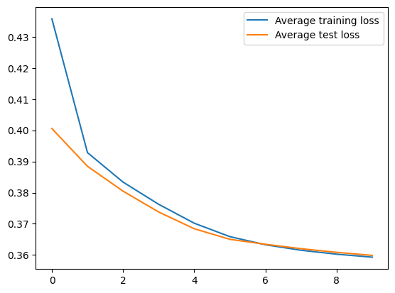
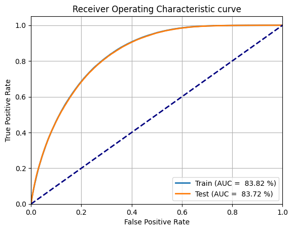
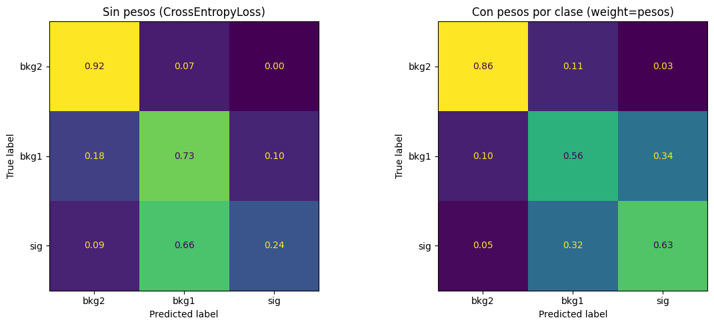
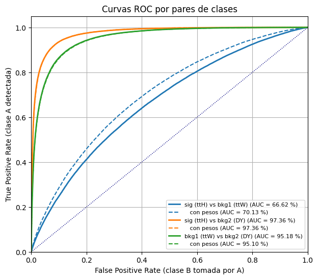
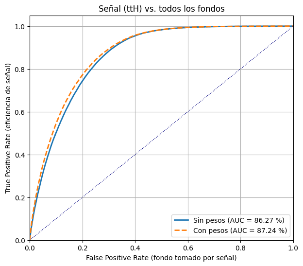
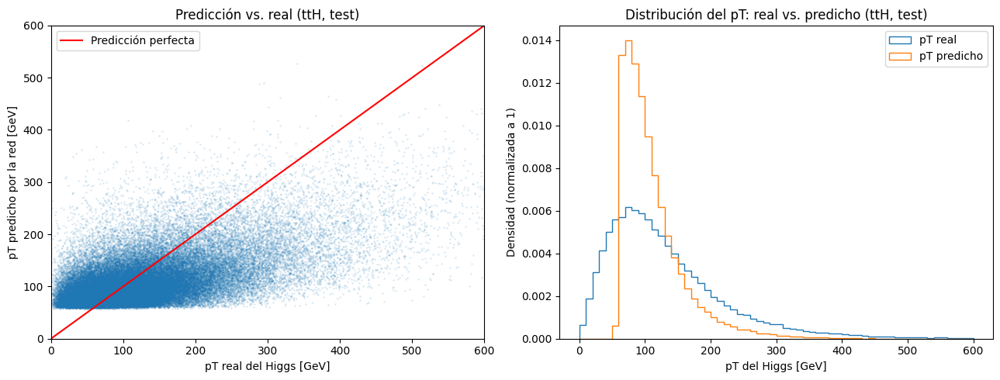
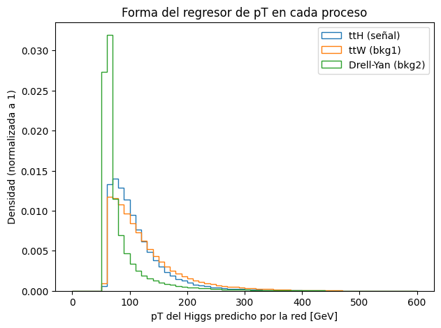
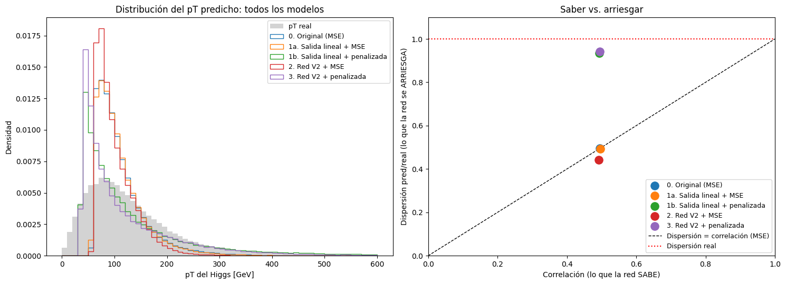

<div align="center">

# ⚛️ Redes neuronales con PyTorch: buscando el bosón de Higgs (ttH)

### Edición extendida, corregida y comentada en español de la práctica **PA_03** de ADFM

[](https://colab.research.google.com/github/DanielV-13/ADFM---PA_03_neural_network_torch.ipynb/blob/main/ADFM_PA_03_neural_network_torch.ipynb)


**Análisis de Datos en Física Moderna (ADFM)**, Universidad de Oviedo · 2026


</div>

---

## 📑 Tabla de contenidos

1. [Sobre el proyecto](#-sobre-el-proyecto)
2. [El problema físico](#%EF%B8%8F-el-problema-físico)
3. [El camino del cuaderno](#%EF%B8%8F-el-camino-del-cuaderno)
4. [Parte 1: clasificación binaria](#-parte-1-clasificación-binaria)
5. [Parte 2: clasificación multiclase](#-parte-2-clasificación-multiclase)
6. [Parte 3: regresión del pT del Higgs](#-parte-3-regresión-del-pt-del-higgs)
7. [Parte 3B: experimentos para mejorar la regresión](#-parte-3b-experimentos-para-mejorar-la-regresión)
8. [Resumen técnico: última capa y función de pérdida](#-resumen-técnico-última-capa-y-función-de-pérdida)
9. [Del cuaderno al CERN real](#-del-cuaderno-al-cern-real)
10. [Lo que aprendí](#-lo-que-aprendí)
11. [Galería visual](#%EF%B8%8F-galería-visual)
12. [Cómo ejecutarlo](#%EF%B8%8F-cómo-ejecutarlo)
13. [Estructura del repositorio](#-estructura-del-repositorio)
14. [Créditos y licencias](#-créditos-y-licencias)

---

## 📌 Sobre el proyecto

Este repositorio contiene mi versión **extendida, corregida y explicada en español** de la práctica de aula *PA_03: neural networks with torch*, creada por el profesor **Pietro Vischia** para la asignatura ADFM.

En la práctica anterior ([PA_02](https://github.com/DanielV-13/ADFM---PA_02_neural_network_from_scratch)) programé una red neuronal **desde cero con NumPy**. Aquí paso a **PyTorch**, la librería estándar de *Deep Learning*, y la aplico a datos **simulados del LHC** para resolver tres tareas distintas: clasificación binaria, clasificación multiclase y regresión.

El cuaderno original contiene errores **intencionados** (los *WHOOPS*), pensados para que el estudiante los diagnostique y los corrija. Gran parte del trabajo consistió en eso.

### ✍️ ¿Qué añadí sobre el cuaderno original?

| Añadido | Descripción |
| :--- | :--- |
| 🧭 **Portada, brief e índice de siglas** | Mapa del camino, resultados principales y glosario de siglas de física y de ML, con enlaces a fuentes oficiales. |
| 🐛 **Corrección de todos los *WHOOPS*** | Escalado aplicado después de crear los `DataLoader`, pérdida mal elegida, `ReLU` muertas, fuga de la columna `index`, valores de relleno −99… |
| 💬 **Comentarios línea por línea** | Todo el código está comentado en español, con markdowns explicativos y analogías. |
| 🖼️ **Diagramas explicativos** | PyTorch, `Dataset`/`DataLoader`, arquitectura, *training loop*, optimizadores, *learning rate*, *one-hot*… |
| ⚛️ **Contexto físico** | El bosón de Higgs, el proceso $t\bar{t}H$, sus fondos y el descubrimiento real en el CERN. |
| 🧪 **Experimentos propios** | Pesos por clase, curvas ROC por pares de clases y **4 experimentos** sobre la regresión, cada uno con hipótesis, predicción y resultado. |
| 🧩 **Resumen técnico** | Tabla de activación final y función de pérdida por tarea, más una demostración de la "*Softmax* doble". |
| 🏁 **Conclusión general** | Un cierre que recorre todo el cuaderno y resume las lecciones. |

---

## ⚛️ El problema físico

Buscamos eventos donde se produce un **bosón de Higgs junto a un par de quarks top** ($t\bar{t}H$). Es un proceso rarísimo: solo ~1 % de los bosones de Higgs se producen así. Además, está escondido entre procesos de fondo que lo imitan.

| Proceso | Papel | ¿Por qué es difícil? |
| :--- | :---: | :--- |
| **$t\bar{t}H$** (Higgs + top–antitop) | 🎯 **Señal** | Mide directamente la interacción entre el Higgs y el quark top, la partícula más pesada |
| **$t\bar{t}W$** (top–antitop + bosón W) | Fondo 1 | Cinemática casi idéntica a la señal: fondo **irreducible** |
| **Drell-Yan** ($Z/\gamma^* \to \ell\ell$) | Fondo 2 | Muy abundante, pero más fácil de separar |

**Datos:** simulaciones Monte Carlo en formato `.root`, leídas con `uproot`, con **23 variables** de entrada por evento: $p_T$, $\eta$, $\phi$ y masa de leptones, jets y del top hadrónico, energía transversal faltante (MET), etc.

| Conjunto | Eventos |
| :--- | ---: |
| Señal $t\bar{t}H$ | 299,287 |
| Fondo $t\bar{t}W$ | 556,648 |
| Fondo Drell-Yan | 1,034,904 |

---

## 🗺️ El camino del cuaderno

| Parte | Tarea | Pregunta | Herramientas clave |
| :---: | :--- | :--- | :--- |
| **0** | Preparación | ¿Cómo cargamos y preparamos los datos? | `uproot`, `pandas`, `StandardScaler`, `Dataset`, `DataLoader` |
| **1** | Clasificación **binaria** | ¿Es $t\bar{t}H$ o es fondo? | `Sigmoid` + `BCELoss`, curva ROC |
| **2** | Clasificación **multiclase** | ¿Es $t\bar{t}H$, $t\bar{t}W$ o Drell-Yan? | *One-hot*, `CrossEntropyLoss`, matriz de confusión, pesos por clase |
| **3** | **Regresión** | ¿Cuál es el $p_T$ del Higgs? | `MSELoss`, transformación logarítmica |
| **3B** | Experimentos | ¿Se puede mejorar el regresor? | Pérdida penalizada, `BatchNorm`, `Dropout` |

**Arquitectura base** (86,737 parámetros): `23 → 512 → 128 → 64 → 8 → salida`, con `ReLU` en las capas ocultas, optimizador `SGD` (lr = 0.01) y `ExponentialLR` (γ = 0.9) durante 10 épocas.

<div align="center">

</div>

---

## 🔵 Parte 1: clasificación binaria

**Objetivo:** separar la señal $t\bar{t}H$ del fondo ($t\bar{t}W$ + Drell-Yan), con 1,103,770 eventos.

### 💥 WHOOPS: la red no aprendía (AUC = 50 %)
| Problema | Corrección |
| :--- | :--- |
| Datos **sin escalar** (valores de cientos y −99) | `StandardScaler` columna por columna, ajustado **solo con train** (sin *data leakage*) y aplicado **antes** de crear los `Dataset` |
| Pérdida incompatible con la salida | `Sigmoid` final + `BCELoss` |
| Capa estrecha de 8 neuronas con `ReLU` "muertas" | `Sigmoid` en esa capa |

### ✅ Resultado
| Métrica | Antes | Después |
| :--- | :---: | :---: |
| AUC train / test | 50 % / 50 % | **83.8 % / 83.7 %** |

Train ≈ test ➜ la red **generaliza** y no memoriza.

<div align="center">


</div>

---

## 🟣 Parte 2: clasificación multiclase

**Objetivo:** distinguir las **3 clases** a la vez. La red devuelve 3 *logits* y se entrena con `CrossEntropyLoss`, que ya incluye la `Softmax` por dentro.

### 🔍 Diagnóstico: la señal se confundía con $t\bar{t}W$
Sin pesos, la red acertaba solo el **24 %** de la señal: el 66 % lo clasificaba como $t\bar{t}W$. La causa es doble: los dos procesos son físicamente muy parecidos y hay un fuerte **desequilibrio de clases** (Drell-Yan ≈ 55 %, $t\bar{t}W$ ≈ 29 %, $t\bar{t}H$ ≈ 16 %).

### ⚖️ Experimento: pérdida ponderada por clase
$$\text{peso}_c = \frac{N_{\text{total}}}{N_{\text{clases}} \cdot N_c} \quad\Rightarrow\quad \text{DY} = 0.61,\; t\bar{t}W = 1.13,\; t\bar{t}H = 2.11$$

| Clase (acierto) | Sin pesos | Con pesos |
| :--- | :---: | :---: |
| Drell-Yan | 92.4 % | 86.2 % |
| $t\bar{t}W$ | 72.6 % | 56.2 % |
| **$t\bar{t}H$ (señal)** | **24.4 %** | **63.3 %** 🚀 |

<div align="center">

</div>

### 📈 Curvas ROC por pares de clases
| Comparación | AUC sin pesos | AUC con pesos |
| :--- | :---: | :---: |
| $t\bar{t}H$ vs. Drell-Yan | 97.4 % | 97.4 % |
| $t\bar{t}W$ vs. Drell-Yan | 95.2 % | 95.1 % |
| **$t\bar{t}H$ vs. $t\bar{t}W$** | **66.6 %** | **70.1 %** |
| $t\bar{t}H$ vs. todos los fondos | 86.3 % | 87.2 % |

<div align="center">


</div>

💡 **Lectura clave:** los pesos cambian mucho la matriz de confusión (+39 puntos en la señal), pero casi nada el AUC (+1 punto). Los pesos **no hacen que la red sepa más**: sobre todo **mueven el punto de trabajo** (el umbral de decisión) a favor de la señal. Es el clásico compromiso **eficiencia ↔ pureza**.

---

## 🟢 Parte 3: regresión del pT del Higgs

**Objetivo:** predecir un **número**, el momento transversal verdadero del Higgs (`Hreco_HTXS_Higgs_pt`), a partir de las 23 variables del detector. Solo se usan eventos de señal.

### 💥 WHOOPS 1: el loss no bajaba de ~23,000
| Problema | Corrección |
| :--- | :--- |
| 59,842 eventos con $p_T$ = **−99** (valor de relleno) | Se eliminan |
| El $p_T$ abarca varios órdenes de magnitud | Se predice **$\ln(p_T)$** y se vuelve a GeV con `np.exp` |
| La columna `label` se colaba como variable de entrada | Se elimina |

### ✅ Resultado y 💥 WHOOPS 2
| Métrica | Valor |
| :--- | :---: |
| MSE de la red ($\ln p_T$) | **0.413** |
| MSE de "predecir siempre la media" | 0.547 |
| Mejora | **24.5 %** |
| Correlación predicción–real | **0.495** |

La red aprende, pero sus predicciones están **comprimidas**: nunca predice menos de ~56 GeV (un "suelo") y subestima los valores altos. Es la **regresión hacia la media**. Aplicado a los fondos, el regresor da para $t\bar{t}W$ una forma casi idéntica a la de $t\bar{t}H$: aprendió algo como "la actividad de un sistema top + bosón", no algo exclusivo del Higgs.

<div align="center">


</div>

---

## 🧪 Parte 3B: experimentos para mejorar la regresión

El cuaderno termina con un reto opcional: *"You can try!"*. Lo acepté y diseñé **4 experimentos**, cambiando **una cosa cada vez**, fijando la semilla y **prediciendo el resultado antes de ejecutar**.

| # | Modelo | MSE | Mejora | Correlación | Dispersión pred/real | pT mín. | Veredicto |
| :---: | :--- | :---: | :---: | :---: | :---: | :---: | :--- |
| 0 | Original (MSE) | 0.413 | 24.5 % | 0.495 | 0.495 | 55.9 GeV | Punto de partida |
| 1 | Original + pérdida penalizada | 22.12 | ❌ | — | 0.000 | 1.0 GeV | 💀 Red "nacida muerta" (*dying ReLU*) |
| 1a | Salida lineal + MSE | **0.413** | **24.6 %** | 0.496 | 0.492 | 56.0 GeV | ✅ Igual de buena y **más segura** |
| 1b | Salida lineal + penalizada | 0.520 | 4.9 % | 0.494 | **0.935** | 34.2 GeV | Mejor **forma**, peor **precisión** |
| 2 | Red V2 (sin `Sigmoid`, con `BatchNorm` y `Dropout`) + MSE | 0.421 | 23.0 % | 0.493 | 0.442 | 57.2 GeV | Igual, con 6 veces menos parámetros |
| 3 | Red V2 + penalizada | 0.527 | 3.6 % | 0.495 | 0.941 | 36.4 GeV | Igual que 1b, con predicciones absurdas (14 TeV) |

<div align="center">

</div>

### 🔬 Hallazgos
1. **Dispersión = correlación con MSE.** Con incertidumbre, la predicción óptima "encoge" hacia la media justo en proporción a lo que la red sabe. Por eso $\text{MSE} = \text{Var}(y)(1-\rho^2) = 0.547 \times (1-0.495^2) \approx 0.413$.
2. **La pérdida penalizada cambia precisión por forma.** La fórmula $\text{MSE} = \text{Var}(y)(1 + s^2 - 2\rho s)$ predijo el error de los experimentos 1b y 3 **casi al decimal**.
3. **Una `ReLU` a la salida puede matar la red** desde la inicialización. En una regresión, la salida debe ser **lineal**.
4. **Hipótesis refutada:** la `Sigmoid` de 8 neuronas **no** era la causa del suelo. Dos redes muy distintas llegan a la **misma correlación (~0.49)**.
5. **El límite está en los datos.** Los neutrinos escapan del detector, así que un Higgs de 10 GeV y uno de 60 GeV dejan huellas casi idénticas. **Una red no puede inventar información que no está en los datos.**

---

## 🧩 Resumen técnico: última capa y función de pérdida

| Parte | Tarea | Receta estándar | Lo que usamos en PyTorch |
| :--- | :--- | :--- | :--- |
| 1 | Clasificación binaria | `Sigmoid` + entropía cruzada binaria | `nn.Sigmoid()` + `nn.BCELoss()` |
| 2 | Clasificación multiclase | `Softmax` + entropía cruzada categórica | **Logits** + `nn.CrossEntropyLoss()` (la `Softmax` va **por dentro**; se aplica a mano solo al evaluar) |
| 3 | Regresión | Ninguna o `ReLU` (para asegurar > 0) + MSE | Primero `ReLU` ($p_T$ en GeV); después **salida lineal** ($\ln p_T$) + `nn.MSELoss()` |

⚠️ **La trampa de la "*Softmax* doble":** si se pone `nn.Softmax()` al final de la red y además se usa `CrossEntropyLoss`, la *Softmax* se aplica dos veces. El cuaderno lo demuestra: con 3 clases, la pérdida **nunca baja de 0.55**, aunque la red acierte con total seguridad, y el gradiente cae a menos de la mitad cuando la red duda.

---

## 🌍 Del cuaderno al CERN real

| En el análisis real del CERN | En este cuaderno |
| :--- | :--- |
| **4 de julio de 2012:** ATLAS y CMS anuncian una nueva partícula de ~125 GeV (5σ). Nobel de Física en 2013 para Englert y Higgs | Contexto físico del cuaderno |
| **2018:** CMS (5.2σ) y ATLAS (6.3σ) observan el proceso $t\bar{t}H$ y miden el acoplamiento Higgs–top, compatible con el Modelo Estándar | Nuestra señal |
| Canal **multileptón**, con algoritmos de ML (BDT, MVA) para separar señal y fondo | Parte 1 |
| $t\bar{t}W$ como fondo irreducible | Parte 2: el par más difícil (AUC ≈ 67–70 %) |
| Medidas en intervalos del $p_T$ del Higgs (marco **STXS**) | Parte 3: regresión de `HTXS_Higgs_pt` |
| Neutrinos invisibles ➜ $p_T$ del Higgs difícil de reconstruir | Parte 3B: el "suelo de información" |

---

## 🎓 Lo que aprendí

1. **Preprocesar bien es la mitad del trabajo:** escalar antes de crear los `DataLoader`, eliminar los valores de relleno y transformar el objetivo cuando abarca varios órdenes de magnitud.
2. **La última capa y la pérdida van en pareja:** `Sigmoid` + BCE, *logits* + `CrossEntropyLoss` (sin *Softmax* doble), salida lineal + MSE.
3. **Un loss que baja no basta:** hay que mirar la ROC, la matriz de confusión, la predicción frente al valor real y las distribuciones.
4. **Experimentar con método:** cambiar una cosa cada vez, fijar la semilla y predecir el resultado **antes** de ejecutar. Una hipótesis refutada también es un resultado.
5. **Una red no inventa información:** si los datos no la contienen, ninguna arquitectura la encontrará.

---

## 🖼️ Galería visual

<details>
<summary><b>Haz clic para ver los diagramas explicativos del cuaderno</b></summary>

<br>

**PyTorch**


**Clasificación binaria y división train/test**


**Escaladores**


**Dataset y DataLoader**


**Cálculo de parámetros**


**Predicciones iniciales y test loop**


**Funciones de pérdida, learning rate y optimizadores**


**One-hot encoding**


</details>

---

## ▶️ Cómo ejecutarlo

### Opción 1: Google Colab (recomendada)
1. Haz clic en [](https://colab.research.google.com/github/DanielV-13/ADFM---PA_03_neural_network_torch.ipynb/blob/main/ADFM_PA_03_neural_network_torch.ipynb).
2. En la celda de configuración, pon `runOnColab = True` (monta Google Drive e instala `uproot`).
3. Ejecuta **Runtime → Run all**. Con GPU va bastante más rápido: *Runtime → Change runtime type → GPU*.

> 💡 El cuaderno pesa unos 37 MB porque lleva las imágenes y los gráficos embebidos. Si GitHub no lo previsualiza, ábrelo en Colab o en [nbviewer](https://nbviewer.org/github/DanielV-13/ADFM---PA_03_neural_network_torch.ipynb/blob/main/ADFM_PA_03_neural_network_torch.ipynb).

### Opción 2: local
```bash
git clone https://github.com/DanielV-13/ADFM---PA_03_neural_network_torch.ipynb.git
cd ADFM---PA_03_neural_network_torch.ipynb
pip install torch torchinfo uproot pandas numpy matplotlib scikit-learn tqdm jupyter
jupyter notebook ADFM_PA_03_neural_network_torch.ipynb
```

📦 **Datos:** el cuaderno los descarga automáticamente (unos cientos de MB) la primera vez que se ejecuta, desde el servidor de la Universidad de Oviedo.

🎲 **Reproducibilidad:** los resultados pueden variar ligeramente entre ejecuciones por la inicialización aleatoria de los pesos y el orden de los lotes.

---

## 📁 Estructura del repositorio

```
ADFM---PA_03_neural_network_torch.ipynb/
├── ADFM_PA_03_neural_network_torch.ipynb   # Cuaderno completo (código + explicaciones + imágenes)
├── img/                                    # Gráficos de resultados usados en este README
└── README.md                               # Este archivo
```

---

## 🙏 Créditos y licencias

| | |
| :--- | :--- |
| 📘 **Cuaderno original** | *PA_03: neural networks with torch* © **Pietro Vischia** (Universidad de Oviedo e ICTEA) · [vischia/adfm](https://github.com/vischia/adfm) |
| 🗃️ **Datos** | Simulaciones $t\bar{t}H$, $t\bar{t}W$ y Drell-Yan preparadas por Pietro Vischia para escuelas de Machine Learning |
| ✍️ **Edición extendida y comentada** | © **Daniel Vaca Velastegui**, 2026 |
| 🤖 **Asistencia** | **Gemini Flash** (Google) y **Claude Opus 5.5** (Anthropic): explicaciones, diagnóstico de errores, diseño de experimentos, diagramas y revisión final |
| 📄 **Referencia** | CMS Collaboration (2018), [*Observation of ttH production*](https://cms.cern/node/1836) |
| 📄 **Referencia** | ATLAS Collaboration (2018), [*Observation of ttH production with ATLAS*](https://arxiv.org/abs/1811.10282) |
| 📄 **Referencia** | [Documentación de PyTorch](https://pytorch.org/docs/stable/index.html) |

---

<div align="center">

**Daniel Vaca Velastegui** · Estudiante de intercambio en la Universidad de Oviedo · ADFM 2026

*"Una red más grande no puede inventar información que no está en los datos."*

</div>
